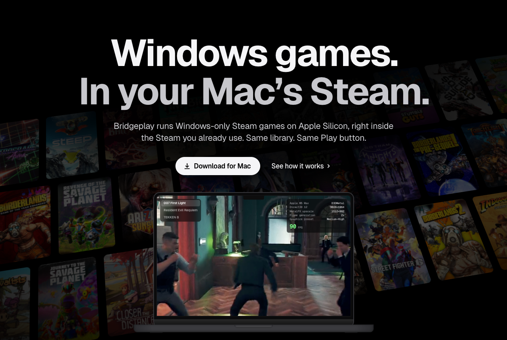
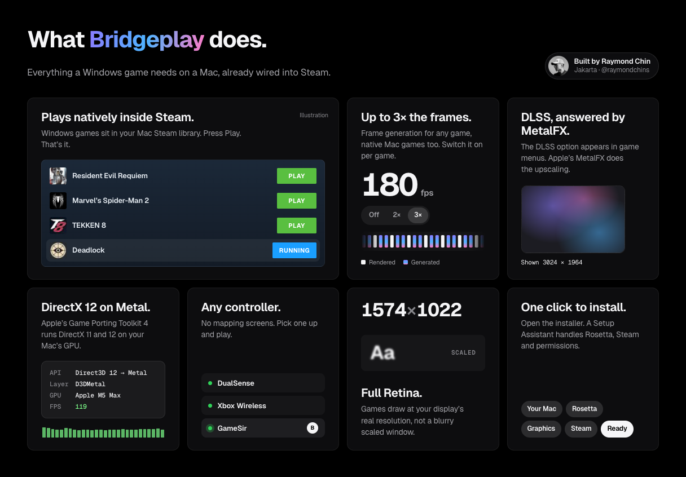
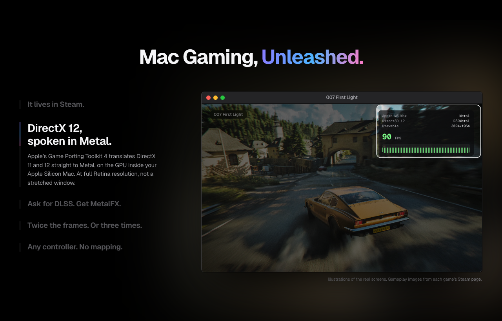
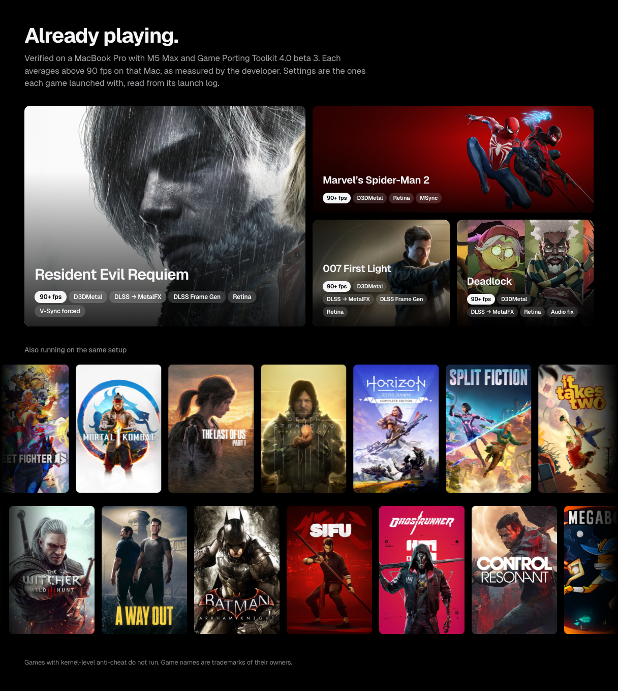
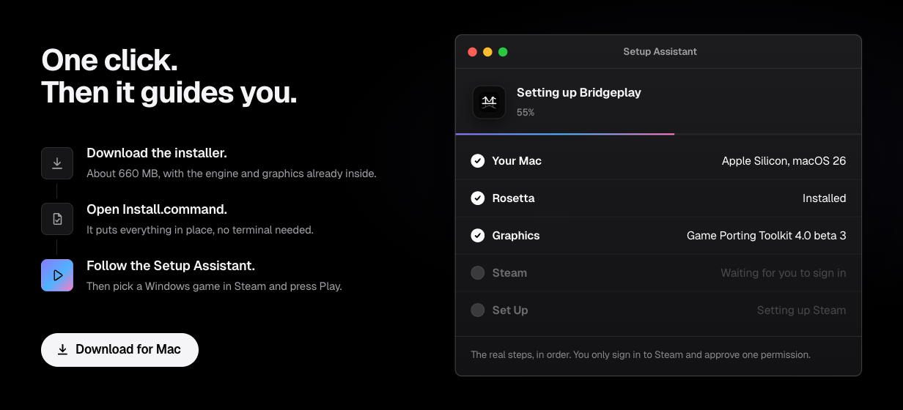
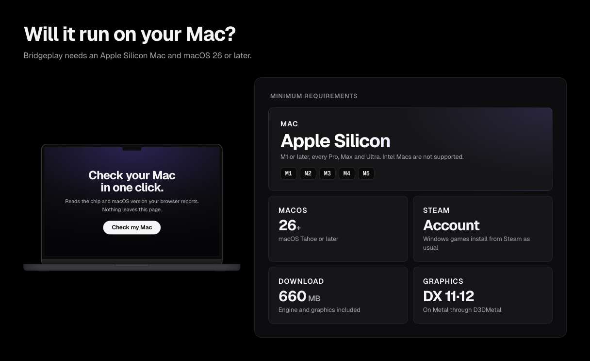

  

  <b>Windows-only Steam games on Apple Silicon, right inside the Steam you already use.</b> 
  Same library. Same Play button. No bottles, no second launcher.

  
  
  
  
  

 

  

## What it does

| | |
|---|---|
| **Plays natively inside Steam** | Windows games sit in your Mac Steam library and start with Play, like Mac games. |
| **DirectX 12 on Metal** | Apple's Game Porting Toolkit 4 (D3DMetal) runs DirectX 11 and 12 on your Mac's GPU. |
| **DLSS, answered by MetalFX** | Games see a DLSS-capable card, so the option shows up. Apple's MetalFX does the upscaling, and DLSS Frame Generation runs on MetalFX interpolation. |
| **Up to 3× the frames** | Built-in frame generation (2×, 3×, adaptive) for any game, native Mac games included, switched on per game from Steam's properties. |
| **Any controller** | DualSense, Xbox, GameSir and other pads work without a mapping screen. |
| **Full Retina** | Games draw at your display's real resolution. |
| **One-click install** | Open the installer and a Setup Assistant handles Rosetta, Steam and permissions. |

  

Illustrations of the real screens.

## Already playing

  

Verified on a MacBook Pro with M5 Max and Game Porting Toolkit 4.0 beta 3, each averaging above 90 fps as measured by the developer. Settings are the ones each game launched with, read from its launch log.

| Game | Launch settings |
|---|---|
| Resident Evil Requiem | D3DMetal · DLSS → MetalFX · DLSS Frame Gen · Retina · V-Sync forced |
| Marvel's Spider-Man 2 | D3DMetal · Retina · MSync |
| 007 First Light | D3DMetal · DLSS → MetalFX · DLSS Frame Gen · Retina |
| Deadlock | D3DMetal · DLSS → MetalFX · Retina · audio fix |
| TEKKEN 8 | D3DMetal · Retina · ranked online |

Also running on the same setup: Street Fighter 6, Mortal Kombat 1, The Last of Us Part I, Death Stranding Director's Cut, Horizon Zero Dawn, Split Fiction, It Takes Two, A Way Out, Batman: Arkham Knight, Sifu, Ghostrunner, Control Resonant, Ravenswatch, Megabonk, PowerWash Simulator 2, The Witcher 3.

Games with kernel-level anti-cheat do not run.

## Install

1. **Download the installer** from [bridgeplay.dev](https://bridgeplay.dev). About 570 MB, with the engine and graphics already inside.
2. **Open `Install.command`.** macOS blocks it the first time: open **System Settings > Privacy & Security**, scroll down, click **Open Anyway** and confirm with your password or Touch ID. It needs an admin account, puts everything in place and downloads Steam from Valve if it is missing.
3. **Follow the Setup Assistant**: Rosetta, graphics, Steam sign-in and a couple of standard macOS prompts.
4. **Press Play** on any Windows game in Steam. The first time you use a controller, allow Steam's Input Monitoring request.

Updates install themselves: Bridgeplay, its patch in Steam and the engine. **Refresh** on the Status page checks on demand.

The installer includes Apple's Game Porting Toolkit redistributables under Apple's license, which allows non-commercial distribution only. Bridgeplay is free and non-commercial.

  

## Requirements

  

| | |
|---|---|
| Mac | Apple Silicon, M1 or later. Intel Macs are not supported. |
| macOS | 26 or later |
| Steam | A Steam account. Windows games install from Steam as usual. |
| Download | About 570 MB. Installing Rosetta 2 and Steam, and signing in to Steam, need internet. |

## How it works

Bridgeplay runs inside the native macOS Steam client and registers itself as a Steam Play compatibility tool. Under the hood:

- **Engine:** CodeWeavers' open-source WineCX 11.17 with MSync, running under Rosetta 2.
- **Graphics:** Apple's Game Porting Toolkit 4.0 beta 3 (D3DMetal). It is not stored in this repository; the installer ships its redistributables under Apple's non-commercial license (see Install). DXMT and DXVK are available for games that prefer them.
- **Extras:** NVAPI/NGX routing for DLSS on MetalFX, in-process frame generation on `CAMetalLayer`, per-game Game Mode, Retina back buffers and a controller layer for HID pads.

Building from source: see [docs/DEVELOPING.md](docs/DEVELOPING.md), [docs/ARCHITECTURE.md](docs/ARCHITECTURE.md) and [docs/BUILD-LOCAL.md](docs/BUILD-LOCAL.md). The one-click installer lives in [`installer/`](installer/) and is packaged by `scripts/package-installer.sh`.

## Credits

Bridgeplay is a fork of [NotProton](https://github.com/NotProtonNot/NotProton) (GPL-3.0), built on CodeWeavers' [WineCX](https://www.codeweavers.com/crossover) and Apple's [Game Porting Toolkit](https://developer.apple.com/games/game-porting-toolkit/). The DualSense Bluetooth bridge and Steam rumble forwarding come from [sn0wst0rm's NotProton fork](https://github.com/sn0wst0rm/NotProton). It also uses [Dobby](https://github.com/jmpews/Dobby) (Apache-2.0), [Sparkle](https://sparkle-project.org) (MIT), [DXMT](https://github.com/3Shain/dxmt) and [DXVK-macOS](https://github.com/Gcenx/DXVK-macOS).

## License

Bridgeplay is licensed under the [GPL-3.0](LICENSE). Third-party licenses, and the source for the patched Wine files the app ships (LGPL-2.1-or-later), are listed in [NOTICE](NOTICE).

  
  &nbsp;Built by <a href="https://github.com/raymondchins"><b>Raymond Chin</b></a>, Jakarta.

Bridgeplay is not affiliated with Apple, Valve, NVIDIA or CodeWeavers. Game Porting Toolkit is Apple software provided under Apple's license for non-commercial use. Steam is a trademark of Valve Corporation. DLSS is a trademark of NVIDIA Corporation. Game names are trademarks of their owners.
